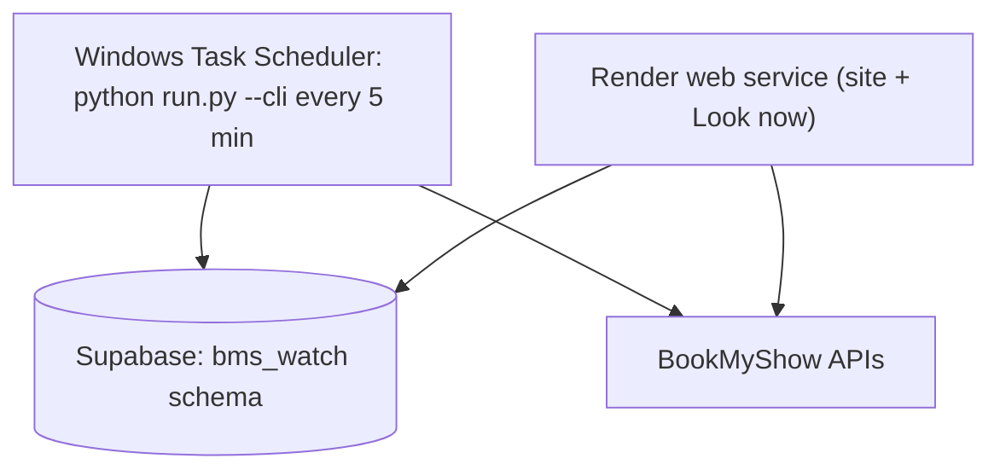

# BMS Watch (CineWatch)

Automated movie ticket availability tracker and alert system for BookMyShow (BMS).

Designed for moviegoers and cinephiles who want first-day-first-show (FDFS) in the formats they want (IMAX / EPIQ / PXL / 4DX) for high-demand releases without having to manually refresh the site every few minutes.

---

## Architecture & How It Works

- **Zero-Dependency Local Execution:** Runs with pure Python 3.12 (standard library). No mandatory Docker, Redis, or Node.js required to run locally.
- **Render Free Tier Deployment (`render.yaml`):** Deploys as a single Docker container web service in `singapore` (`ap-southeast-1`) with health check at `/api/health`.
- **Supabase database:** Watches, check state and alert logs live in the shared Supabase project (schema `bms_watch`), reached through its REST API with `SUPABASE_SECRET_KEY`. The Render site and the local scheduled check (`python run.py --cli`, run every 5 minutes by Windows Task Scheduler) share that one database. Local SQLite only caches BookMyShow film lists.



---

## Supabase Integration (Shared Project, Dedicated Schema)

This app integrates with your shared Supabase project (`ismyhkcsxrswqsfzfrxe`):

- **Shared Auth & User Database:** Shares `auth.users` with `evenly`. Users can log in with their existing account or sign in with a 6-digit email OTP.
- **Dedicated PostgreSQL Schema (`bms_watch`):** To avoid table name collisions with `public` or `evenly` (e.g. `evenly.groups`), all BMS Watch tables live inside their own isolated schema:
  - `bms_watch.watches` (Row-Level Security: users only see and manage their own watches)
  - `bms_watch.alert_logs`
  - `bms_watch.state_cache`
- **Migration Script:** The complete SQL schema is in [`supabase/migrations/20261119000000_bms_watch_schema.sql`](./supabase/migrations/20261119000000_bms_watch_schema.sql).
- **PostgREST Configuration:** In the Supabase Dashboard, go to **Settings > API > PostgREST > Exposed Schemas** and add `bms_watch` alongside `public` and `evenly`.

---

## Quick Start (Local)

### 1. Configure Environment

Copy `.env.example` to `.env` and configure your email credentials:

```bash
cp .env.example .env
```

`.env`:
```ini
SMTP_USER=mishal0404@gmail.com
SMTP_PASS=your_gmail_app_password
MAIL_TO=mishal0404@gmail.com
SMTP_HOST=smtp.gmail.com
SMTP_PORT=465
```

### 2. Run Modes

#### Mode A: Full Web Dashboard & Background Poller (Recommended)
```bash
python run.py
```
Open **`http://localhost:8000`** in your browser:
- City auto-detected from your location (or type to search any BookMyShow city).
- New-watch form: pick a film, dates from today / release day onwards (bookable dates marked), cinemas multi-select, formats.
- Active Watches Dashboard with Pause / Resume / Delete actions.
- "Check Availability Now" manual trigger.

#### Mode B: Fast Terminal CLI Check (Like the initial script)
```bash
python run.py --cli
# OR:
python bms_watch.py
```

#### Mode C: Continuous Terminal Poller
```bash
python run.py --loop 180  # Checks every 180 seconds in terminal
```

#### Mode D: Offline Self-Tests
```bash
python run.py --test
```

---

## Render + Supabase Deployment

This repository includes a [`render.yaml`](./render.yaml) file configured for Render's free tier.

### Environment Variables on Render:

| Variable | Description | Default / Example |
| :--- | :--- | :--- |
| `PORT` | Service port | `10000` |
| `DATA_DIR` | Local container directory | `/data` |
| `SUPABASE_SECRET_KEY` | Supabase server key (reads/writes watches) | *(Secret)* |
| `SMTP_USER` | Email sender address | *(Secret)* |
| `SMTP_PASS` | Gmail App Password | *(Secret)* |

Redeploys lose nothing: all state is in Supabase. The container's `/data` only holds a film-list cache.
