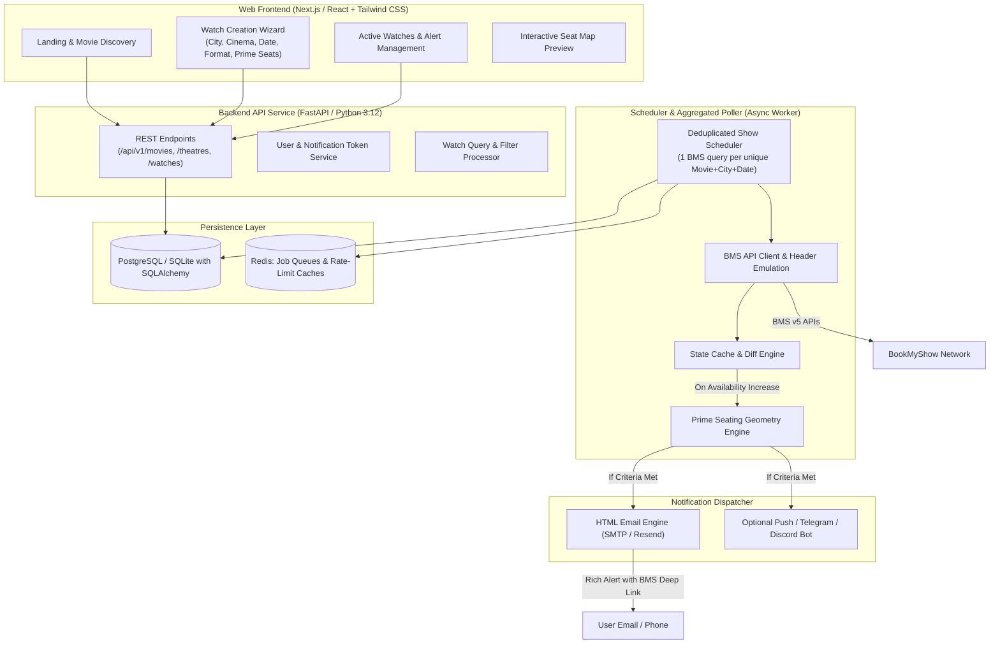
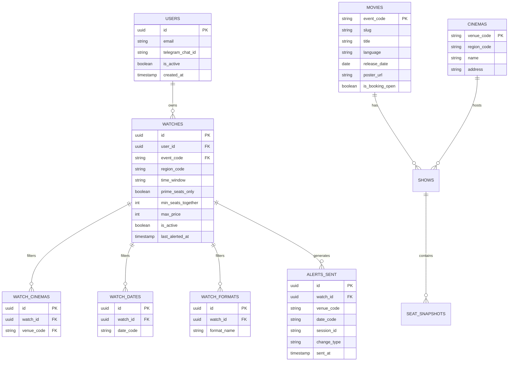
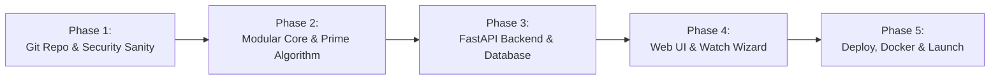

# BMS Watch (CineWatch) — Comprehensive Development & Architecture Plan

## Executive Summary

**BMS Watch** is an automated ticket availability tracker, prime seat finder, and notification platform for movie enthusiasts. Ticketing platforms like BookMyShow (BMS) do not notify users when advance bookings open for high-demand releases (e.g., IMAX, EPIQ, PXL, 4DX blockbusters), nor do they notify users when prime seats (sweet-spot center rows and recliners) become available due to cancellations or new screen allocations.

This document outlines the end-to-end architecture, feature specifications, algorithmic design for prime seating detection, reverse-engineered BMS data pipeline, database models, tech stack, and step-by-step implementation roadmap for transforming the standalone `bms_watch.py` script into a production-grade full-stack web platform backed by a private GitHub repository.

---

## 1. System Architecture Overview



---

## 2. Core Features & What's Possible

### A. Movie Selection & Pre-Release ("Coming Soon") Watches
* **Now Showing Tracker:** Instant search across currently playing movies in any selected city with real-time show status.
* **Pre-Release / "Just About To Release" Watcher:**
  * Allows creating watches for unreleased blockbusters before bookings or showtimes even appear on BookMyShow (e.g. *Avengers: Doomsday*, *Avatar 3*, major festival releases).
  * System periodically queries BMS's event catalog and city listings for the event code.
  * **Zero-to-One Alert:** As soon as the very first theatre or date opens bookings in that city, users receive a high-priority *"BOOKINGS OPEN!"* blast.
* **Language & Audio Track Selector:** Filter shows by language (e.g., English, Hindi, Tamil, Telugu) and audio format (Dolby Atmos, 7.1, IMAX audio).

### B. Geo, Cinema & Date Multi-Selection
* **City / Region Selection:** Support for all BMS region codes (e.g., Coimbatore `COIM`, Bengaluru `BANG`, Mumbai `MUMBAI`, Delhi-NCR `NCR`, Chennai `CHEN`, Hyderabad `HYD`, Kochi `KOCH`, Pune `PUNE`, etc.).
* **Cinema Multi-Select & Favorites:**
  * Select specific theatres (e.g., Broadway Cinemas Coimbatore, PVR Brookefields, INOX Prozone, Cinepolis) OR select **"All Cinemas in City"**.
  * Grouping by theatre chains and premium brands (PVR INOX, Cinepolis, Broadway, SPI Cinemas).
* **Flexible Date Selection:**
  * Specific date picker (e.g., Dec 17, 18, 19).
  * Smart date presets:
    * **Opening Weekend** (Thursday preview through Sunday).
    * **Opening Day** (First screening date).
    * **Any Weekend** (Friday evening to Sunday night).

### C. Experience & Screen Format Filtering
* **Specialty Format Toggles:**
  * **IMAX:** IMAX 2D, IMAX 3D, IMAX with Laser.
  * **Large Format:** EPIQ, PXL, BigPix, ScreenX, ICE Immersive.
  * **Special Experience:** 4DX, MX4D, INSIGNIA, Gold Class, Director's Cut.
  * **Standard:** Standard 2D, Standard 3D.
* **Time-of-Day Windows:**
  * Early Morning (before 9:00 AM) — popular for fan shows / first-day-first-show (FDFS).
  * Morning (9:00 AM – 12:00 PM).
  * Matinee / Afternoon (12:00 PM – 4:00 PM).
  * Evening (4:00 PM – 8:00 PM).
  * Night (8:00 PM – 12:00 AM).
  * Late Night / Midnight (after 12:00 AM).
* **Price Cap Filter:** Set a maximum ticket price per seat (e.g., alert only if $\le ₹450$).

### D. Prime Seating Identification ("The Sweet Spot Engine")
Ticketing sites only indicate whether a show has seats (`AVAILABLE`, `FAST FILLING`, `ALMOST FULL`). However, a show marked `AVAILABLE` might only have front-row neck-strain seats left.

Our Prime Seating Engine evaluates seat coordinates and metadata to ensure notifications only trigger when genuine prime seats exist:

```
Screen:  ============================================================== (FRONT)
Row A:   [ 1 ][ 2 ][ 3 ] ... [Neck-Strain Zone] ... [ 28 ][ 29 ][ 30 ]
Row B:   [ 1 ][ 2 ][ 3 ] ... [Avoid: Viewing Angle > 35°] ... [ 28 ]
...
Row H:   [ 1 ][ 2 ]   |------ [PRIME SWEET SPOT: ROWS G-M] ------|   [ 29 ]
Row J:   [ 1 ][ 2 ]   |  Center 35% - 65% of screen width         |   [ 29 ]
Row K:   [ 1 ][ 2 ]   |  Eye-level vertical axis (15° - 25°)       |   [ 29 ]
Row L:   [ 1 ][ 2 ]   |  Acoustic center (surround balance)       |   [ 29 ]
...
Row P:   [ 1 ][ 2 ]   |--- [PREMIUM RECLINER ROW (Club/VIP)] ---|    [ 24 ]
Rear:    ============================================================== (PROJECTION)
```

#### Algorithmic Parameters for Prime Detection:
1. **Vertical Depth (Row Index):**
   * Default prime row range: $40\% \text{ to } 85\%$ of total auditorium depth from screen.
   * Eliminates the front $0\% - 35\%$ rows (neck strain, off-axis distortion).
2. **Horizontal Centering (Seat Index):**
   * Center $35\% \text{ to } 65\%$ of the physical row width.
   * Formula: $\text{Prime Seats} = \left\{ s_i \;\middle|\; \text{int}(0.35 \times N) \le i \le \text{int}(0.65 \times N) \right\}$ where $N$ is total seats in that row.
3. **Contiguous Quantity Requirement:**
   * User can require $K$ adjacent seats (e.g. 2 seats together, 3 seats, 4 seats) rather than isolated single seats scattered in the row.
4. **Category / Tier Prioritization:**
   * Filter specifically for `Recliner`, `Club`, `Elite`, `Executive`, or `Balcony` pricing tiers.
5. **Two-Stage Polling Efficiency:**
   * Stage 1: Lightweight showtime poll checks status (`availStatus > 0`).
   * Stage 2: Only when a show is bookable does the worker fetch seat layout data to analyze prime seats. This minimizes upstream BMS traffic by 98%.

### E. Notification & Alert Channels
* **Rich HTML Email Notifications:**
  * Mobile-responsive layout matching BookMyShow's signature branding.
  * Direct 1-click booking link: `https://in.bookmyshow.com/booktickets/{venueCode}/{sessionId}`
  * Clear badge summary: Cinema name, screen format (e.g., `Broadway EPIQ`), show date/time, and prime seat count.
  * Instant 1-click **"Pause Watch"** or **"Unsubscribe"** button in footer.
* **Smart Alert Throttling:**
  * Prevents inbox flooding. Once alerted, the watch enters a configurable cooldown (e.g. 15 minutes) unless a new cinema opens or availability rank increases.
* **Additional Notification Channels (Possible Extensions):**
  * **Telegram Bot:** Instant push alert with interactive inline buttons ("Book Now", "Snooze 1h").
  * **WhatsApp Alerts:** Via Twilio or Cloud API.
  * **Web Push (PWA):** Browser notification even when the tab is closed.
  * **Discord / Slack Webhooks:** For cinephile groups and discord servers.

---

## 3. BMS API Reverse Engineering & Scraping Architecture

### Endpoints Leveraged
1. **Showtimes & Status Endpoint:**
   * `GET https://in.bookmyshow.com/api/movies-data/v5/showtimes-by-event/primary-dynamic`
   * Params: `etCodes`, `dateCode`, `regionCode`, `isDesktop=true`, `language`, `refEventCode`.
   * Returns: Full list of venues, screens, formats, showtimes, availability pills (`AVAILABLE`, `FAST FILLING`, `ALMOST FULL`, `SOLD OUT`), session IDs (`sessionId`), and price breakdown.
2. **Seat Layout & Availability Endpoint:**
   * Internal session seat layout data via BMS web/mobile API (`/api/movies-data/v5/seat-layout` or web booking session query).
   * Returns: Physical row labels, grid seat numbers, pricing categories, and individual seat booking statuses (`0 = Available`, `1 = Booked`, `2 = Locked/Held`).
3. **Region Discovery Endpoint:**
   * `GET https://in.bookmyshow.com/api/explore/v1/discover/regions`
   * Provides list of all supported cities, city slugs, and region codes.
4. **Movie Search & Catalog Endpoint:**
   * `GET https://in.bookmyshow.com/api/explore/v1/discover/movies`
   * Provides now-showing and upcoming movies list with event codes (`ET...`), release dates, and posters.

### Anti-Bot & Scalability Strategy
* **Request Aggregation / Fan-Out:**
  * If 500 users in Coimbatore create watches for *Avengers: Doomsday* on Dec 18, the poller executes **only 1 request** to BMS every 60 seconds. The diff is calculated once and fanned out to all 500 subscribers.
* **Header & Identity Emulation:**
  * Exact matching of BMS web headers (`User-Agent`, `x-app-code: WEB`, `x-platform-code: DESKTOP-WEB`, `x-region-code`, `Referer`).
* **Jitter & Backoff:**
  * Randomized poll intervals (e.g. $60\text{s} \pm 12\text{s}$) to avoid robotic periodicity patterns.
  * Automatic exponential backoff if HTTP 429 or 403 response is detected.

---

## 4. Database Schema Design



---

## 5. Technology Stack Selection

| Component | Recommended Technology | Justification |
| :--- | :--- | :--- |
| **Backend API** | **FastAPI (Python 3.12)** | Asynchronous, auto-generates Swagger/OpenAPI docs, natively reuses existing Python BMS scraper logic. |
| **Scheduler & Worker** | **APScheduler / Celery + Redis** | Handles lightweight periodic polling tasks, exponential backoff, and distributed job execution. |
| **Frontend Framework** | **Next.js 14+ (App Router) or Vite + React** | Fast, responsive UI with server-side rendering for movie pages and client-side watch builder. |
| **UI Styling** | **Tailwind CSS + shadcn/ui** | Modern dark-mode cinephile aesthetic, accessible components, and responsive mobile-first views. |
| **Database** | **PostgreSQL** (Prod) / **SQLite** (Dev) | Relational integrity for user watches, cinemas, and audit trails; easily managed with SQLAlchemy 2.0 & Alembic. |
| **Email Delivery** | **Resend / Postmark / SMTP** | High deliverability, template support, and webhook bounce handling. |
| **Version Control** | **Private GitHub Repository (`zayn0001/bms-watch`)** | Standard CI/CD with GitHub Actions, secret management, and issues tracking. |
| **Containerization** | **Docker & Docker Compose** | Reproducible local and production deployment (API, Worker, Frontend, Redis, Postgres). |

---

## 6. Project Directory Structure

```
bms_watch/
├── .github/
│   └── workflows/
│       ├── test.yml                 # Linting and pytest workflow
│       └── docker-build.yml         # Container build on main branch
├── .env.example                     # Environment template (NO SECRETS)
├── .gitignore                       # Ignores .env, logs, pycache, state.json
├── docker-compose.yml               # Multi-service stack (db, redis, api, worker, web)
├── README.md                        # Setup and developer documentation
│
├── backend/                         # FastAPI Application
│   ├── app/
│   │   ├── api/                     # REST routes (/v1/movies, /theatres, /watches)
│   │   ├── core/                    # Config (pydantic-settings), security, logging
│   │   ├── db/                      # SQLAlchemy models, session, migrations (alembic)
│   │   ├── schemas/                 # Pydantic request/response schemas
│   │   ├── scraper/                 # BMS API reverse-engineered client
│   │   │   ├── client.py            # Async HTTP client with headers & rate-limiting
│   │   │   ├── parser.py            # Showtimes & venue parser
│   │   │   ├── prime_seating.py     # Sweet-spot geometry detection algorithm
│   │   │   └── diff.py              # Availability diff engine
│   │   ├── services/                # Notification & watch matching logic
│   │   │   ├── email_service.py     # HTML email builder & SMTP/Resend sender
│   │   │   └── watch_matcher.py     # Matches scraped changes against user criteria
│   │   └── main.py                  # FastAPI entry point
│   ├── tests/                       # Pytest test suite
│   ├── Dockerfile
│   └── pyproject.toml / requirements.txt
│
├── worker/                          # Background Poller Service
│   ├── scheduler.py                 # Periodic job orchestrator (APScheduler / Celery)
│   └── tasks.py                     # Scrape jobs & alert dispatchers
│
└── frontend/                        # Web UI (Next.js or React SPA)
    ├── src/
    │   ├── app/                     # Pages (Catalog, Watch Wizard, Dashboard)
    │   ├── components/              # UI components (CinemaPicker, FormatFilters, SeatMap)
    │   ├── hooks/                   # React Query / data fetching hooks
    │   └── lib/                     # API client & helpers
    ├── package.json
    └── tailwind.config.js
```

---

## 7. Step-by-Step Implementation Roadmap



### Phase 1: Repository Setup & Security Hardening (Immediate)
1. Initialize Git in the local `bms_watch` workspace.
2. Create `.gitignore` to strictly exclude `.env`, `*.log`, `state.json`, and `__pycache__`.
3. Sanitize `bms_watch.py` to extract credentials into environment variables (`.env`).
4. Create private GitHub repository `zayn0001/bms-watch` via `gh cli` and push initial baseline.

### Phase 2: Core Scraper & Prime Seating Algorithm Engine
1. Refactor scraper into an asynchronous client with connection pooling (`httpx` / `aiohttp`).
2. Implement upcoming/pre-release movie status poller.
3. Implement `prime_seating.py`:
   * Center 35%–65% column calculations.
   * Row depth tiering (middle-to-back 40%–80%).
   * Contiguous $N$-seats adjacent verification.
4. Unit tests verifying prime seating classification against simulated cinema layouts.

### Phase 3: Backend API & Data Persistence
1. Setup FastAPI with Pydantic v2 validation.
2. Build SQLAlchemy models for Users, Watches, Cinemas, Formats, and History.
3. Expose REST endpoints:
   * `GET /api/v1/regions` (searchable BMS cities)
   * `GET /api/v1/movies` (now showing + upcoming catalog)
   * `GET /api/v1/cinemas?region=COIM` (cinemas in city)
   * `POST /api/v1/watches` (create watch with email, filters, prime seating)
   * `DELETE /api/v1/watches/{id}` & `GET /api/v1/watches/unsubscribe/{token}`
4. Integrate background scheduler with smart deduplication.

### Phase 4: Modern Web Frontend
1. Build responsive web application (Next.js 14 / Vite React + Tailwind CSS).
2. Clean Step-by-Step Watch Wizard:
   * Step 1: Search movie or select from "Coming Soon" blockbusters.
   * Step 2: Choose city & select cinemas (with "Select All IMAX / EPIQ / PXL" quick-filters).
   * Step 3: Choose dates & formats.
   * Step 4: Toggle "Prime Seating Only" & specify number of seats.
   * Step 5: Enter email and verify watch.
3. Visual interactive seat grid diagram showing what the "Sweet Spot" entails.

### Phase 5: Containerization, Testing & Deployment
1. Compose `docker-compose.yml` and `Dockerfile` for unified container and Render deployment.
2. Setup GitHub Actions CI/cron for scheduled checking (`cron-check.yml` every 10 min).
3. Supabase Storage S3 mirror (`mirror.py`) syncing state between ephemeral cloud nodes and Supabase.

---

## 9. Implementation Architecture: TV & Remote Control Experience

### A. Cinema CRT / OLED TV Aesthetic
* **Dual-Panel Cinema Monitor**:
  * Curved glass bezel with CRT scanline raster effect and dynamic glow.
  * Live On-Screen Display (OSD) banner showing channel number, tuned city, audio mode (STEREO / ATMOS), and 24-hour digital clock.
* **Channels Roster**:
  * **Channel 01 (`CH 01: NOW SHOWING`)**: Live movie grid with high-resolution poster art, event codes (`ET...`), slugs, and one-click "TUNE WATCH" action.
  * **Channel 02 (`CH 02: COMING SOON`)**: Live upcoming satellite stream for pre-release blockbusters.
  * **Channel 03 (`CH 03: ACTIVE RADAR`)**: Live ticket watches with pulsating status indicators, instant enable/pause toggles, and delete controls.
  * **Channel 04 (`CH 04: SEAT RADAR`)**: Optical & acoustic sweet-spot heat map visualizer displaying screen curve, front neck-strain warnings, and optimal center tiers.
  * **Channel 05 (`CH 05: PROGRAMMER`)**: Tactical watch creation tuner with date presets, cinema multi-tags, format pills, prime seating toggle, and auto-filled user email.

### B. Tactile Handheld TV Remote Control
* Ergonomic dark-charcoal remote chassis with simulated infrared emitter LED that blinks on button press.
* **Remote Keypad**:
  * **Power Button**: Toggles TV standby mode (powers monitor off with scanline collapse animation).
  * **City Tuner Dropdown**: Direct region changer (Mumbai, Bengaluru, Coimbatore, Delhi-NCR, Hyderabad, etc.).
  * **Numeric Channel Keys (1–5)**: Direct channel jump.
  * **Channel Rocker (`CH ▲` / `CH ▼`)**: Sequential channel navigation.
  * **D-Pad & `OK` Button**: Tactile navigation controls.
  * **Teletext Macro Buttons**:
    * 🔴 Red: Scan Now (`POST /api/check-now`)
    * 🟢 Green: Program New Watch (Jump to CH 05)
    * 🟡 Yellow: Sweet Spot Matrix (Jump to CH 04)
    * 🔵 Blue: Account & Supabase OTP Modal

### C. Live Reverse-Engineered BMS APIs
* **Regions Discovery**: `https://in.bookmyshow.com/api/explore/v1/discover/regions`
* **Movies Discovery**: `https://in.bookmyshow.com/api/explore/v1/discover/movies`
  * Requires dynamic `x-bms-id` UUID header and region code/slug query parameters.
  * Caches responses in-memory for 10 minutes to respect BookMyShow rate limits.

### D. Supabase Auth & Multi-App Schema Isolation (`evenly` Pattern)
* **Auth Reuse**: Replicates `evenly`'s 6-digit email OTP modal (`verifyOtp({ email, token, type: 'signup' })`), passwordless sign-in, and account registration with `options.data.app = 'bms_watch'`.
* **Database Isolation**: Dedicated `bms_watch` PostgreSQL schema (`bms_watch.watches`, `bms_watch.state_cache`, `bms_watch.alert_logs`) with Row Level Security (RLS) policies scoped to `auth.uid() = user_id`. Grants strictly applied to `authenticated` and `service_role`.
* **Supabase Client**: Configured with `{ db: { schema: 'bms_watch' } }`.
